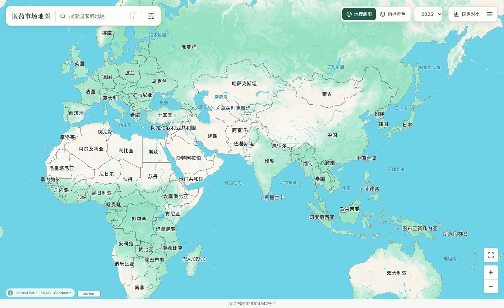

# 医药市场地图 · Pharma Market Atlas

为做制剂出口和市场研究的人做的一张世界地图。点选国家，可以把当地人口、购买力、医疗支付、药品准入和渠道放在同一份档案里看。遇到需要核实的政策，也能顺着资料卡找到当地的药监机构。

[打开正式网站](https://ginnay.cn/)

[](https://ginnay.cn/)

## 在地图上能做什么

- 搜索国家和地区，或直接点选国界。放大后可以看到首都、主要城市、河流、港口和道路。
- 在国家概览中查看人口、人均 GDP、卫生支出、政府卫生支付比例、平均寿命和老龄化比例。按年份查看分布，或把最多四个国家放在一起比较。
- 国家档案支持药监网站、贸易图表、采购与支付方式、准入政策和各地人文资料。正式站持续更新这些专题。

## 在自己的电脑上运行

使用 Python 3.11 或更高版本、Node.js 22 和 npm。在仓库根目录运行以下命令。

```sh
python3 -m venv .venv
. .venv/bin/activate
python -m pip install -r requirements.txt

cd frontend
npm ci
npm run build
cd ..

python -m uvicorn backend.app:app --host 127.0.0.1 --port 8780
```

在浏览器打开 [本机地图](http://127.0.0.1:8780/)。首次启动会从仓库内的数据生成独立的 SQLite 数据库。访客可直接浏览地图。开发前端时，在后端运行期间另开一个终端，在 `frontend` 目录运行 `npm run dev`。

## 仓库自带哪些资料

仓库附有 241 个国家和地区的世界银行统计快照、地图图层及城市标注。六项指标保留来源、许可和观测年份，缺失年份在界面内留空。中国、印度尼西亚和墨西哥的药监网站目录展示了资料卡与官方查询入口之间的关联。

正式站的持续研究库、第三方授权贸易数据以及人文图库单独维护。用自己的数据时，国家索引和统计序列放在 `data/snapshot.json`，资料卡放在 `data/profiles.json`，人文条目可按国家代码存入 `data/humanity-published/`。数据库首次导入后，通过本机 `/admin` 的编辑与发布功能维护资料。不同的数据库可用 `MARKET_DB_PATH` 分开保存。

## 结构

| 目录 | 内容 |
| --- | --- |
| `frontend/src/` | React、TypeScript 和 MapLibre 地图，国家侧栏、对比图表与资料编辑界面 |
| `backend/` | FastAPI 接口、SQLite 发布版本、访客数据过滤和资料审核 |
| `data/` | 可公开再分发的指标、地图图层和国家档案示例 |
| `scripts/` | 世界银行统计抓取与小比例尺底图生成 |

世界银行、Natural Earth、GeoNames 和国旗图形的出处与许可见[数据与素材说明](ATTRIBUTION.md)。
